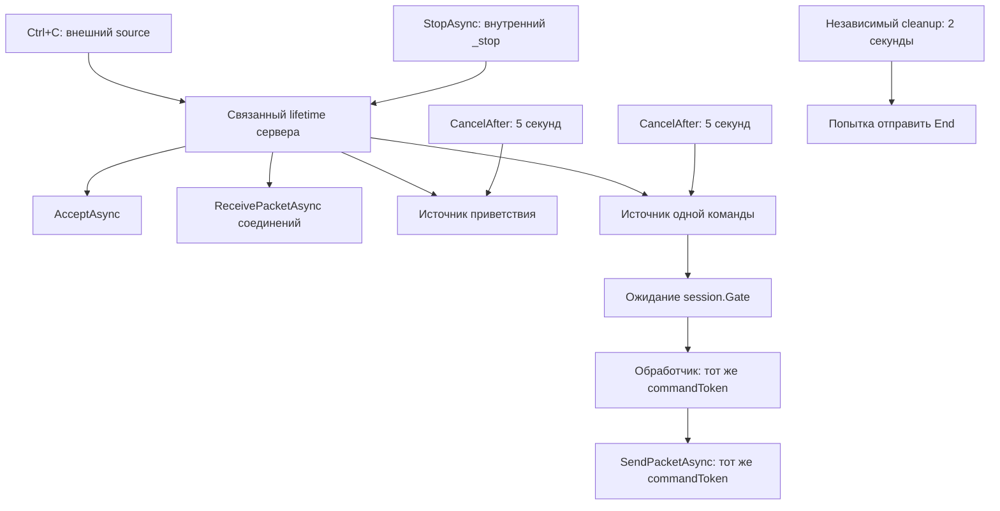

# WordGuesser: практические кейсы с кодом

Короткий справочник по неочевидным решениям проекта. Каждый кейс содержит задачу, объяснение, фрагмент **актуального исходного кода** и разбор эффекта или ограничения. Фрагменты извлечены из файлов; это части методов, а не отдельные компилируемые программы. Номера строк относятся к состоянию проекта при подготовке документа.

Сетевой код использует только `Socket`, без транспортных обёрток. `Memory`, семафоры и статические методы протокола не заменяют сокет: они описывают буфер, синхронизацию и порядок вызовов его API.

Основной акцент — корректность и понятная модель. Производительность не измерялась бенчмарками: уменьшение копирований и оценки O(1)/O(L) выводятся из кода, а не являются обещанием конкретного ускорения.

Другие документы: [правила и запуск](README.md), [контракт протокола](../WordGuesser.Protocol/README.md), [подробный архитектурный разбор](DEVELOPMENT_NOTES.md).

## Карта отмены в текущем коде



Связи означают распространение запроса отмены, а не последовательность создания потоков. Отмена ребёнка не отменяет родителя. На клиенте внешний токен связан с `lifetime` для чтения ввода и сети; тайм-аут отправки создаётся от токена этой петли. Источник подключения связан напрямую с внешним токеном. Прощальный `End` использует независимый короткий источник.

Важно различать четыре действия:

| Действие | Что делает | Чего не делает |
| --- | --- | --- |
| `Cancel()` / `CancelAsync()` | Запрашивает отмену и запускает обработчики отмены | Не завершает принудительно произвольный код и не ждёт все Tasks приложения |
| `CancelAfter(...)` | Планирует запрос отмены источника по времени | Не приостанавливает выполнение до истечения срока |
| `Task.Delay(..., ct)` | Даёт ожидаемую паузу, которую можно отменить | Не отменяет сам переданный токен |
| `Dispose()` у source | Освобождает его ресурсы | Не заменяет запрос отмены |

## Содержание


**Пакеты и память**

- [01. Где заканчивается пакет](#case-01)
- [02. Почему одного ReceiveAsync недостаточно](#case-02)
- [03. Почему SendAsync тоже вызывается в цикле](#case-03)
- [04. Memory — область буфера, которую можно сохранить через await](#case-04)
- [05. ReadOnlyMemory не означает неизменяемый массив](#case-05)
- [06. Срез remaining[sent..] не копирует остаток](#case-06)
- [07. AsMemory указывает, куда именно писать полученные байты](#case-07)
- [08. Почему Span есть в парсере, но не заменяет Memory в сети](#case-08)
- [09. Обычный EOF и оборванный пакет различаются](#case-09)

**Кодирование и контракт**

- [10. Пакет строится только один раз](#case-10)
- [11. Почему UTF-8 строгий и без BOM](#case-11)
- [12. Почему лимит — в байтах, а не string.Length](#case-12)
- [13. Порядок байтов числа — часть протокола](#case-13)
- [14. Проверка диапазона должна предшествовать приведению к byte](#case-14)
- [15. Типизированный Decode не прячет ошибку за default](#case-15)
- [16. record для результата удобен и в обработчике, и в тесте](#case-16)

**Соединения и сервер**

- [17. Bind, Listen и Accept выполняют разные задачи](#case-17)
- [18. Коннект поддерживается задачей обработки, а не циклом переподключения](#case-18)
- [19. Зачем хранить Socket → Task и когда удалять запись](#case-19)
- [20. Почему StopAsync не ограничивается Cancel](#case-20)
- [21. await using ждёт асинхронную очистку](#case-21)

**Отмена, цепочки и таймеры**

- [22. CancellationTokenSource управляет, CancellationToken наблюдает](#case-22)
- [23. Как объединяются остановка сервера и Ctrl+C](#case-23)
- [24. Как к общему токену добавляется тайм-аут команды](#case-24)
- [25. CancelAfter — таймер отмены, а не пауза](#case-25)
- [26. Тайм-аут обработки не ограничивает получение пакета](#case-26)
- [27. Почему для прощального End нужен независимый токен](#case-27)
- [28. Токен очистки не должен наследовать уже случившийся сбой](#case-28)
- [29. Почему WaitAsync семафора расположен до try](#case-29)
- [30. Cancel и CancelAsync не равны ожиданию задач](#case-30)
- [31. Почему исключения при остановке фильтруются через when](#case-31)
- [32. Task.Delay — отдельный вид ожидания времени](#case-32)
- [33. Отменить ожидание ReadLine — не значит отменить ReadLine](#case-33)

**Синхронизация и сессии**

- [34. Два семафора нужны для разных направлений](#case-34)
- [35. Зачем ConditionalWeakTable без обёртки Socket](#case-35)
- [36. Два индекса вместо перебора всех сессий](#case-36)
- [37. Почему ConcurrentDictionary не заменяет атомарную операцию Join](#case-37)
- [38. Блокировка реестра и очередь сессии решают разные задачи](#case-38)
- [39. Удаление сессии раньше отправки End](#case-39)

**Диспетчеризация и игра**

- [40. Reflection выполняется один раз, а не на каждый пакет](#case-40)
- [41. Сервер проверяет роль по сокету, а не верит интерфейсу](#case-41)
- [42. Почему неверная длина не съедает ход](#case-42)
- [43. Пять попыток закончились: кто получает очко](#case-43)
- [44. Переставляем ссылки игроков, а не переносим их очки](#case-44)
- [45. Матч заканчивается отдельным событием](#case-45)

**Клиент и консоль**

- [46. Task.WhenAny ждёт ввод и сеть одновременно](#case-46)
- [47. Когда ввод и пакет готовы вместе, сеть обрабатывается первой](#case-47)
- [48. Pending запрещает повтор до подтверждения](#case-48)
- [49. IClientUi позволяет проверять настоящий клиент без ручного ввода](#case-49)
- [50. Почему при завершении нужно наблюдать оставшиеся задачи](#case-50)
- [51. Перерисовка сообщения сохраняет набранное слово](#case-51)

**Примеры проверок**

- [52. Порт 0 позволяет ОС выбрать свободный порт](#case-52)
- [53. Shutdown(Send) помогает проверить оборванное сообщение](#case-53)

<a id="case-01"></a>
## 01. Где заканчивается пакет

TCP не сохраняет границы отправленных сообщений. Поэтому пакет читается по собственной длине: заголовок задаёт число байтов данных, а полный размер равен длине плюс четыре служебных байта. Завершающий маркер проверяется парсером в ожидаемой позиции. Нельзя считать первый встретившийся 0x03 концом: это значение допустимо и в полезной нагрузке.

**Код:** [WordGuesser.Protocol/GuessSocketExtensions.cs](../WordGuesser.Protocol/GuessSocketExtensions.cs), строки 63–72.

```csharp
            var length = header[GuessPackageMeta.LengthByteIndex];
            if (length > GuessPackageMeta.PayloadMaxByte)
                throw new InvalidDataException("Invalid packet length.");

            var packet = new byte[length + 4];
            header.CopyTo(packet, 0);
            await ReceiveExactlyAsync(socket, packet.AsMemory(header.Length), ct);
            var parsed = GuessPackageParser.TryParse(packet, out var response);
            if (parsed == null) throw new InvalidDataException($"Invalid packet: {response}.");
            return parsed;
```

**Эффект и ограничения.** Это исправление корректности. Лимит проверяется до выделения массива полного пакета. На один пакет выделяется не больше 100 байт в этом массиве; число соединений и суммарная память этим не ограничиваются.


<a id="case-02"></a>
## 02. Почему одного ReceiveAsync недостаточно

Получатель просит записать данные в оставшуюся область, но Socket вправе вернуть меньше байтов. Например, для ожидаемых 20 байтов могут прийти сначала 8, затем 12. Цикл уменьшает область на фактический результат и заканчивается только после её заполнения. Этот метод вызывается для остатка заголовка и тела пакета.

**Код:** [WordGuesser.Protocol/GuessSocketExtensions.cs](../WordGuesser.Protocol/GuessSocketExtensions.cs), строки 82–91.

```csharp
    private static async Task ReceiveExactlyAsync(Socket socket, Memory<byte> remaining, CancellationToken ct)
    {
        while (!remaining.IsEmpty)
        {
            var received = await socket.ReceiveAsync(remaining, SocketFlags.None, ct);
            if (received == 0) throw new EndOfStreamException("Connection closed inside a packet.");
            remaining = remaining[received..];
        }
    }
}
```

**Эффект и ограничения.** Обеспечивает дочитывание при любой фрагментации. Нулевой результат внутри сообщения означает обрыв, а не повод повторять чтение бесконечно. Дополнительный большой буфер накопления здесь не требуется.


<a id="case-03"></a>
## 03. Почему SendAsync тоже вызывается в цикле

Socket.SendAsync возвращает число реально отправленных байтов. Следующая отправка должна начинаться после них. Если отправить весь массив повторно, получатель увидит дублированный префикс; если закончить после первого вызова, пакет может оказаться недополученным. В проекте эта работа выполняется напрямую через Socket, без потоковой обёртки.

**Код:** [WordGuesser.Protocol/GuessSocketExtensions.cs](../WordGuesser.Protocol/GuessSocketExtensions.cs), строки 29–35.

```csharp
            ReadOnlyMemory<byte> remaining = packet;
            while (!remaining.IsEmpty)
            {
                var sent = await socket.SendAsync(remaining, SocketFlags.None, ct);
                if (sent == 0) throw new IOException("Socket stopped sending before the packet was complete.");
                remaining = remaining[sent..];
            }
```

**Эффект и ограничения.** Это гарантия полной отправки при успешном завершении метода. Она не подтверждает обработку сообщения удалённым приложением. Нулевая отправка до конца пакета считается ошибкой, чтобы избежать бесконечного цикла.


<a id="case-04"></a>
## 04. Memory — область буфера, которую можно сохранить через await

Memory<byte> описывает доступную для записи область памяти. В нашем случае она ссылается на часть обычного массива. После await эта область нужна снова: цикл получает результат и сдвигает её границу. Memory можно хранить в состоянии асинхронного метода. Span не может жить через границу await, поэтому для длительной асинхронной операции выбран Memory.

**Код:** [WordGuesser.Protocol/GuessSocketExtensions.cs](../WordGuesser.Protocol/GuessSocketExtensions.cs), строки 82–91.

```csharp
    private static async Task ReceiveExactlyAsync(Socket socket, Memory<byte> remaining, CancellationToken ct)
    {
        while (!remaining.IsEmpty)
        {
            var received = await socket.ReceiveAsync(remaining, SocketFlags.None, ct);
            if (received == 0) throw new EndOfStreamException("Connection closed inside a packet.");
            remaining = remaining[received..];
        }
    }
}
```

**Эффект и ограничения.** Memory не создаёт собственный массив и не делает сеть быстрее сам по себе. Выигрыш здесь — возможность задавать часть буфера без копирования и удобно передавать её асинхронному API. Исходный массив должен оставаться доступным до завершения операции.


<a id="case-05"></a>
## 05. ReadOnlyMemory не означает неизменяемый массив

При отправке сокету нужно читать данные, а не записывать их, поэтому используется ReadOnlyMemory<byte>. Но read-only относится к доступу через это представление. Другой код, у которого осталась ссылка byte[] на тот же массив, всё ещё может его изменить. Поэтому пакет нельзя изменять во время отправки.

**Код:** [WordGuesser.Protocol/GuessSocketExtensions.cs](../WordGuesser.Protocol/GuessSocketExtensions.cs), строки 29–35.

```csharp
            ReadOnlyMemory<byte> remaining = packet;
            while (!remaining.IsEmpty)
            {
                var sent = await socket.SendAsync(remaining, SocketFlags.None, ct);
                if (sent == 0) throw new IOException("Socket stopped sending before the packet was complete.");
                remaining = remaining[sent..];
            }
```

**Эффект и ограничения.** Это выражение намерения в типе и уменьшение возможностей случайной записи. Это не глубокая неизменяемость и не защита от изменения через другую ссылку. Текущие вызывающие методы создают пакет и передают его на отправку без такого изменения.


<a id="case-06"></a>
## 06. Срез remaining[sent..] не копирует остаток

Здесь remaining имеет тип ReadOnlyMemory<byte>. Операция с диапазоном создаёт новое представление той же памяти с другим смещением. Важно смотреть на тип слева: похожий срез обычного массива может создавать новый массив. Одна и та же короткая запись не обещает одинаковые расходы для всех типов.

**Код:** [WordGuesser.Protocol/GuessSocketExtensions.cs](../WordGuesser.Protocol/GuessSocketExtensions.cs), строки 32–34.

```csharp
                var sent = await socket.SendAsync(remaining, SocketFlags.None, ct);
                if (sent == 0) throw new IOException("Socket stopped sending before the packet was complete.");
                remaining = remaining[sent..];
```

**Эффект и ограничения.** В цикле досылки нет копирования всех оставшихся байтов после каждого частичного результата. Это конкретное уменьшение выделений и копирований. При этом сам исходный пакет ранее уже был выделен в памяти.


<a id="case-07"></a>
## 07. AsMemory указывает, куда именно писать полученные байты

header.AsMemory(0, 1) разрешает первому чтению заполнить только первый байт. Затем header.AsMemory(1) обозначает остальную часть того же массива. Для тела используется аналогичная область packet.AsMemory(header.Length). Сокет получает явно заданную границу, поэтому не забирает байты следующего пакета в текущий буфер.

**Код:** [WordGuesser.Protocol/GuessSocketExtensions.cs](../WordGuesser.Protocol/GuessSocketExtensions.cs), строки 54–63.

```csharp
            var header = new byte[GuessPackageMeta.PackagePayloadIndex];
            if (await socket.ReceiveAsync(header.AsMemory(0, 1), SocketFlags.None, ct) == 0)
            {
                socket.Dispose();
                return null;
            }
            if (header[0] != GuessPackageMeta.Start)
                throw new InvalidDataException("Invalid packet start.");
            await ReceiveExactlyAsync(socket, header.AsMemory(1), ct);
            var length = header[GuessPackageMeta.LengthByteIndex];
```

**Эффект и ограничения.** Не создаётся отдельный массив для каждого участка. Это не означает чтение из сети без копирования вообще: ОС и Socket всё равно передают байты в указанный буфер.


<a id="case-08"></a>
## 08. Почему Span есть в парсере, но не заменяет Memory в сети

Парсер синхронный и принимает ReadOnlySpan<byte>, поэтому может просматривать входные данные без дополнительного массива для каждого среза. Однако полезная нагрузка в конце явно копируется через ToArray. Возвращаемый byte[] существует независимо от временного представления входного пакета и удобен для обработчиков.

**Код:** [WordGuesser.Protocol/GuessPackageParser.cs](../WordGuesser.Protocol/GuessPackageParser.cs), строки 36–41.

```csharp
        var command = (Command)data[GuessPackageMeta.CommandByteIndex];
        
        var payload = data.Slice(GuessPackageMeta.PackagePayloadIndex, length).ToArray();

        commandResponse = CommandResponse.Ok;
        return (command, payload);
```

**Эффект и ограничения.** Span уменьшает промежуточные копирования, но текущий парсер не является zero-copy. На приёме создаются заголовок, полный пакет и отдельная нагрузка. Для коротких сообщений это простой контракт времени жизни памяти.


<a id="case-09"></a>
## 09. Обычный EOF и оборванный пакет различаются

Первый байт читается отдельно, чтобы отличить «новое сообщение вообще не началось» от «сообщение началось и оборвалось». Если до первого байта Socket возвращает 0, метод возвращает null. Если 0 получен в ReceiveExactlyAsync, возникает EndOfStreamException.

**Код:** [WordGuesser.Protocol/GuessSocketExtensions.cs](../WordGuesser.Protocol/GuessSocketExtensions.cs), строки 55–59.

```csharp
            if (await socket.ReceiveAsync(header.AsMemory(0, 1), SocketFlags.None, ct) == 0)
            {
                socket.Dispose();
                return null;
            }
```

**Эффект и ограничения.** Это позволяет верхнему уровню трактовать обычное закрытие без ошибки формата. В обоих сценариях соединение не продолжают использовать. Проверка socket.Connected не заменяет реальное чтение и не доказывает, что удалённая сторона доступна прямо сейчас.


<a id="case-10"></a>
## 10. Пакет строится только один раз

Методы команд уже создают готовый кадр. BuildPacket строит его, проверяет формат полезной нагрузки и возвращает байты. Повторно заворачивать их в GuessPackageBuilder нельзя: получится заголовок внутри данных, который клиент ошибочно примет за GUID, роль или текст.

**Код:** [WordGuesser.Protocol/GuessCommandHelper.cs](../WordGuesser.Protocol/GuessCommandHelper.cs), строки 10–15.

```csharp
    private static byte[] BuildPacket(byte[] payload, Command command)
    {
        var packet = new GuessPackageBuilder(payload, command).Build();
        Decode(command, payload);
        return packet;
    }
```

**Эффект и ограничения.** Основной результат — правильный формат. Удаление двойной упаковки дополнительно уменьшило трафик и копирование, но это следствие исправления ошибки. Проверка Decode при построении сама добавляет работу.


<a id="case-11"></a>
## 11. Почему UTF-8 строгий и без BOM

ASCII не умеет передавать русские слова. UTF8Encoding(false, true) задаёт кодирование без добавляемой преамбулы и отказ от молчаливой замены недопустимых последовательностей. Байты повреждённого слова не должны превращаться в похожее допустимое слово. При декодировании соответствующая ошибка преобразуется в FormatException.

**Код:** [WordGuesser.Protocol/GuessCommandHelper.cs](../WordGuesser.Protocol/GuessCommandHelper.cs), строки 8–8.

```csharp
    private static readonly Encoding TextEncoding = new UTF8Encoding(false, true);
```

**Эффект и ограничения.** Это поддержка языка и контроль повреждённых данных. Три буквы КОТ занимают шесть байтов, поэтому протокол считает длину после кодирования. Флаг BOM здесь не является запретом на любой символ U+FEFF внутри входящих данных: допустимость текста проверяется отдельно.


<a id="case-12"></a>
## 12. Почему лимит — в байтах, а не string.Length

На вход сборщика приходит уже закодированный byte[]. Поэтому content.Length — именно размер на линии связи. Полный кадр содержит ещё четыре байта. У Word и Guess текстовый GUID вместе с двоеточием занимает 37 байт, и из 96 остаётся 59 на слово: максимум 29 русских или 59 английских букв.

**Код:** [WordGuesser.Protocol/GuessPackageBuilder.cs](../WordGuesser.Protocol/GuessPackageBuilder.cs), строки 8–15.

```csharp
        if (content.Length > GuessPackageMeta.PayloadMaxByte)
        {
            throw new ArgumentException("Payload exceed maximum byte");
        }

        _package = new byte[4 + content.Length];
        
        CreateBasePackage(content, command);
```

**Эффект и ограничения.** Ограничивает размер отдельного сообщения. Это не универсальный лимит пользовательского ввода: консоль может накопить более длинную строку, ошибка возникнет при построении пакета. Двоичный GUID сэкономил бы место, но изменил бы контракт.


<a id="case-13"></a>
## 13. Порядок байтов числа — часть протокола

Роль кодируется как int в little-endian. Значение 1000 представлено байтами E8 03 00 00. Явный WriteInt32LittleEndian не оставляет формат на усмотрение архитектуры машины. Декодирование использует симметричный ReadInt32LittleEndian.

**Код:** [WordGuesser.Protocol/GuessCommandHelper.cs](../WordGuesser.Protocol/GuessCommandHelper.cs), строки 23–28.

```csharp
    private static byte[] Encode(PlayerRole role)
    {
        var bytes = new byte[sizeof(int)];
        BinaryPrimitives.WriteInt32LittleEndian(bytes, (int)role);
        return bytes;
    }
```

**Эффект и ограничения.** Это переносимость, а не измеренная оптимизация. Новые поля счёта и попыток занимают один байт, потому что их значения малы; для одного байта вопрос порядка байтов не возникает.


<a id="case-14"></a>
## 14. Проверка диапазона должна предшествовать приведению к byte

Если сначала привести произвольный int к byte, значение 256 может превратиться в 0. Для кода ответа это особенно опасно: 0 означает Ok. Поэтому сначала проверяется, что передан известный элемент enum, и только затем выполняется преобразование.

**Код:** [WordGuesser.Protocol/GuessCommandHelper.cs](../WordGuesser.Protocol/GuessCommandHelper.cs), строки 72–77.

```csharp
    public static byte[] CommandResponse(CommandResponse commandResponse)
    {
        if (!Enum.IsDefined(commandResponse))
            throw new ArgumentOutOfRangeException(nameof(commandResponse));
        return BuildPacket([(byte)commandResponse], Command.CommandResponse);
    }
```

**Эффект и ограничения.** Предотвращает превращение ошибочных данных в успешный ответ. Экономия одного байта не оправдывает молчаливое усечение значения. Аналогичный принцип применён к счёту и попыткам в GameEventCodec.


<a id="case-15"></a>
## 15. Типизированный Decode не прячет ошибку за default

Если команда содержит строку, а вызывающий код запросил Guid, это ошибка контракта. Возвращать Guid.Empty или другой default было бы опасно: обработчик продолжил бы работу с вымышленным значением. Метод бросает FormatException, если декодированный объект не соответствует ожидаемому типу.

**Код:** [WordGuesser.Protocol/GuessCommandHelper.cs](../WordGuesser.Protocol/GuessCommandHelper.cs), строки 147–151.

```csharp
    public static T Decode<T>(Command command, byte[] payload)
    {
        object? decoded = Decode(command, payload);
        return decoded is T val ? val : throw new FormatException($"Command {command} does not contain {typeof(T).Name}.");
    }
```

**Эффект и ограничения.** Делает ошибку явной. Использование object внутри декодера предполагает преобразования и возможный boxing числовых значений; это удобный общий интерфейс, а не максимально дешёвая сериализация.


<a id="case-16"></a>
## 16. record для результата удобен и в обработчике, и в тесте

После чтения компактных байтов обработчик получает объект с именованными полями. RoundResult.Won понятнее обращения payload[0] в игровом клиенте. Positional record также даёт сравнение по значениям, поэтому тест может сравнить ожидаемый результат целиком.

**Код:** [WordGuesser.Protocol/GameEventCodec.cs](../WordGuesser.Protocol/GameEventCodec.cs), строки 5–7.

```csharp
public sealed record AttemptResult(int AttemptsLeft, string Mask);
public sealed record RoundResult(bool Won, int YourScore, int OpponentScore, int AttemptsLeft, string Word);
public sealed record MatchResult(bool Won, int YourScore, int OpponentScore);
```

**Эффект и ограничения.** Это читаемость и проверяемость. Record здесь является отдельным объектом и не устраняет выделение памяти. Разбор структуры сообщения остаётся в одном кодеке.


<a id="case-17"></a>
## 17. Bind, Listen и Accept выполняют разные задачи

Bind связывает слушающий сокет с локальным адресом и портом, Listen включает приём подключений, а AcceptAsync позже возвращает отдельный Socket конкретного клиента. Слушающий сокет не используется для передачи игровых команд. Весь транспорт остаётся на прямом Socket API.

**Код:** [WordGuesserServer/WgServer.cs](../WordGuesserServer/WgServer.cs), строки 25–31.

```csharp
        _server = new Socket(endPoint.AddressFamily, SocketType.Stream, ProtocolType.Tcp);
        try
        {
            _server.Bind(endPoint);
            _server.Listen(32);
            EndPoint = (IPEndPoint)_server.LocalEndPoint!;
        }
```

**Эффект и ограничения.** Listen(32) задаёт очередь ожидающих принятия подключений, а не максимум в 32 активных игрока. Глобального лимита соединений в этом коде нет. Ограничение в два участника применяется отдельно к каждой сессии.


<a id="case-18"></a>
## 18. Коннект поддерживается задачей обработки, а не циклом переподключения

На каждое принятое соединение создаётся одна задача HandleConnection. Она читает команды до EOF, отмены или ошибки. Сокет всё это время остаётся открытым. Асинхронное ожидание не требует закреплённого заблокированного потока на каждого игрока. Отдельный Task.Run вокруг обработчика не нужен.

**Код:** [WordGuesserServer/WgServer.cs](../WordGuesserServer/WgServer.cs), строки 70–74.

```csharp
                var connection = await _server.AcceptAsync(ct);
                var task = HandleConnection(connection, ct);
                _connections[connection] = task;
                _ = task.ContinueWith(completed => { _connections.TryRemove(connection, out _); },
                    CancellationToken.None, TaskContinuationOptions.ExecuteSynchronously, TaskScheduler.Default);
```

**Эффект и ограничения.** Экономит потоки во время ожидания ввода-вывода. Но здесь нет heartbeat, автоматического reconnect и восстановления сессии. Задача в словаре означает активную обработку, а не доказанную сетевую доступность клиента в эту секунду.


<a id="case-19"></a>
## 19. Зачем хранить Socket → Task и когда удалять запись

Словарь нужен, чтобы при остановке найти живые сокеты и дождаться их обработчиков. Продолжение регистрируется после записи в словарь. Если задача закончилась очень быстро, ExecuteSynchronously позволяет сразу выполнить удаление уже добавленной записи. Если сначала подписаться, а потом добавить, можно оставить запись о завершённой задаче.

**Код:** [WordGuesserServer/WgServer.cs](../WordGuesserServer/WgServer.cs), строки 71–74.

```csharp
                var task = HandleConnection(connection, ct);
                _connections[connection] = task;
                _ = task.ContinueWith(completed => { _connections.TryRemove(connection, out _); },
                    CancellationToken.None, TaskContinuationOptions.ExecuteSynchronously, TaskScheduler.Default);
```

**Эффект и ограничения.** Обеспечивает управление жизненным циклом. ExecuteSynchronously — разрешение выполнить короткое продолжение синхронно, не обещание отдельного потока или гарантированного ускорения. Даже выполняющийся с ошибкой обработчик должен пройти cleanup.


<a id="case-20"></a>
## 20. Почему StopAsync не ограничивается Cancel

Отмена сообщает операциям о завершении работы, закрытие сокетов выводит их из сетевого ожидания, а WhenAll ждёт фактического конца задач и их finally. Снимок активных соединений берётся после выхода из accept-цикла: новых принятых сокетов этот цикл уже не добавит.

**Код:** [WordGuesserServer/WgServer.cs](../WordGuesserServer/WgServer.cs), строки 82–88.

```csharp
            await lifetime.CancelAsync();
            _server.Dispose();
            // No further accepts can add connections after this point.
            var remaining = _connections.ToArray();
            foreach (var (socket, _) in remaining) socket.Dispose();
            await Task.WhenAll(remaining.Select(pair => pair.Value));
            _connections.Clear();
```

**Эффект и ограничения.** Это корректное завершение, а не мгновенное убийство задач. CancelAsync сам по себе не ждёт все игровые обработчики; для этого нужен отдельный Task.WhenAll. При аварийном завершении процесса исполнение finally не гарантируется.


<a id="case-21"></a>
## 21. await using ждёт асинхронную очистку

WgServer реализует IAsyncDisposable. Выход из области await using вызывает DisposeAsync и ожидает StopAsync. Это удобно, когда освобождение ресурса включает не только закрытие дескриптора, но и ожидание нескольких задач. При исключении конструктора объект ещё не создан; его частично открытый сокет освобождается в catch конструктора.

**Код:** [WordGuesserServer/Program.cs](../WordGuesserServer/Program.cs), строки 23–27.

```csharp
            await using var server = new WgServer(new IPEndPoint(address, port));
            Console.WriteLine($"WordGuesser server listening on {server.EndPoint}. Press Ctrl+C to stop.");
            await server.StartServer(cancellation.Token);
            Console.WriteLine("Server stopped.");
            return 0;
```

**Эффект и ограничения.** Сокеты не остаются жить только потому, что управление вышло из обычного сценария. IDisposable и IAsyncDisposable сами по себе не предотвращают принудительное завершение процесса.


<a id="case-22"></a>
## 22. CancellationTokenSource управляет, CancellationToken наблюдает

Source принадлежит коду, который имеет право отменить работу. Его Token передаётся исполнителям, которым нужно узнать об отмене. В обработчике Ctrl+C сначала задаётся e.Cancel = true, чтобы не завершать процесс немедленно, затем вызывается cancellation.Cancel(). Это даёт приложению возможность выполнить очистку.

**Код:** [WordGuesserClient/Program.cs](../WordGuesserClient/Program.cs), строки 19–21.

```csharp
        using var cancellation = new CancellationTokenSource();
        ConsoleCancelEventHandler onCancel = (_, e) => { e.Cancel = true; cancellation.Cancel(); };
        Console.CancelKeyPress += onCancel;
```

**Эффект и ограничения.** Разделяет управление и выполнение. Токен не является потоком и не прерывает произвольную инструкцию. Метод должен проверить его сам либо передать API, умеющему отменяться. Dispose источника освобождает ресурсы, но не заменяет Cancel.


<a id="case-23"></a>
## 23. Как объединяются остановка сервера и Ctrl+C

Сервер может останавливаться через собственный _stop или через внешний токен вызывающей программы. Linked source объединяет эти причины по принципу «любая из них отменена». Его Token становится общим сигналом для AcceptAsync и задач соединений.

**Код:** [WordGuesserServer/WgServer.cs](../WordGuesserServer/WgServer.cs), строки 64–65.

```csharp
        using var lifetime = CancellationTokenSource.CreateLinkedTokenSource(_stop.Token, externalToken);
        var ct = lifetime.Token;
```

**Эффект и ограничения.** Связь направленная: отмена родителя отменяет связанный источник; отмена связанного источника не отменяет родителей. Это позволяет завершить RunAsync, не изменяя чужой внешний источник отмены.


<a id="case-24"></a>
## 24. Как к общему токену добавляется тайм-аут команды

Каждая уже полученная команда получает дочерний источник. Он отменится либо вместе с сервером, либо по собственным пяти секундам. commandToken передаётся в реестр сессий и дальше обработчику, семафору и сокету. Пять секунд включают ожидание очереди сессии, а не только отправку ответа.

**Код:** [WordGuesserServer/WgServer.cs](../WordGuesserServer/WgServer.cs), строки 105–107.

```csharp
                using var commandTimeout = CancellationTokenSource.CreateLinkedTokenSource(ct);
                commandTimeout.CancelAfter(TimeSpan.FromSeconds(5));
                var commandToken = commandTimeout.Token;
```

**Эффект и ограничения.** Одна просроченная команда не отменяет весь сервер: дочерняя отмена вверх не распространяется. Однако её обработчик завершит соответствующее соединение и выполнит очистку. Это ограничение ожидания, а не игровое правило «игрок должен ответить за пять секунд».


<a id="case-25"></a>
## 25. CancelAfter — таймер отмены, а не пауза

CancelAfter планирует будущую отмену источника; выполнение сразу идёт дальше к ConnectAsync. Если соединение установлено раньше, ждать десять секунд не нужно. Время отсчитывается от вызова CancelAfter, а не от первого фактического ожидания внутри сетевого API.

**Код:** [WordGuesserClient/GameClient.cs](../WordGuesserClient/GameClient.cs), строки 44–46.

```csharp
            using var timeout = CancellationTokenSource.CreateLinkedTokenSource(ct);
            timeout.CancelAfter(TimeSpan.FromSeconds(10));
            await _socket.ConnectAsync(_host, _port, timeout.Token);
```

**Эффект и ограничения.** Не блокирует поток на весь срок. Таймер не обещает выполнение в точную миллисекунду и не задаёт жёсткий предел для кода, который игнорирует токен. В текущем Start источник подключения объявлен через using var на всю область try и освобождается в конце этой области; после ConnectAsync его токен больше не управляет игровой петлёй.


<a id="case-26"></a>
## 26. Тайм-аут обработки не ограничивает получение пакета

Обратите внимание на порядок строк: сначала читается полный пакет с общим токеном, и только затем создаётся таймер команды. Клиент, который отправил часть заголовка и замолчал, не будет отключён именно этим пятсекундным таймером. Для чтения нужен отдельный дедлайн, если такая политика требуется.

**Код:** [WordGuesserServer/WgServer.cs](../WordGuesserServer/WgServer.cs), строки 103–107.

```csharp
                var packet = await connection.ReceivePacketAsync(ct);
                if (packet == null) break;
                using var commandTimeout = CancellationTokenSource.CreateLinkedTokenSource(ct);
                commandTimeout.CancelAfter(TimeSpan.FromSeconds(5));
                var commandToken = commandTimeout.Token;
```

**Эффект и ограничения.** Это важная граница реализации, а не оптимизация. Аналогично таймер отправки команды на клиенте не ограничивает последующее ожидание ответа сервера. Проверка активности и дедлайны ответов пока отдельно не реализованы.


<a id="case-27"></a>
## 27. Почему для прощального End нужен независимый токен

К моменту Ctrl+C основной токен клиента уже отменён. Передать его в SendPacketAsync означало бы не дать отправке даже начаться. Поэтому LeaveAsync создаёт новый источник с двумя секундами и пытается отправить End перед закрытием сокета. Он не связан с отменённым lifetime.

**Код:** [WordGuesserClient/GameClient.cs](../WordGuesserClient/GameClient.cs), строки 149–155.

```csharp
    private async Task LeaveAsync()
    {
        if (!_socket.Connected || (SessionId == null && Pending is not (Command.Create or Command.Join))) return;
        using var timeout = new CancellationTokenSource(TimeSpan.FromSeconds(2));
        try { await _socket.SendPacketAsync(GuessCommandHelper.End(), timeout.Token); }
        catch (Exception ex) when (ex is IOException or SocketException or ObjectDisposedException or OperationCanceledException) { }
    }
```

**Эффект и ограничения.** Даёт короткую возможность корректно уведомить сервер, не зависая навсегда. Доставка не гарантирована. Проверка Connected — только предварительная подсказка; поэтому ошибки реальной отправки всё равно перехватываются.


<a id="case-28"></a>
## 28. Токен очистки не должен наследовать уже случившийся сбой

При ошибке или отмене обычной команды её токен уже может быть непригоден для любых следующих операций. Очистка получает самостоятельные две секунды, чтобы удалить сессию и по возможности сообщить об этом оставшимся участникам. После очистки исходное исключение пробрасывается выше.

**Код:** [WordGuesserServer/GameSessionRegistry.cs](../WordGuesserServer/GameSessionRegistry.cs), строки 82–84.

```csharp
            using var cleanup = new CancellationTokenSource(TimeSpan.FromSeconds(2));
            await EndAsync(session, ct: cleanup.Token);
            throw;
```

**Эффект и ограничения.** Отделяет завершение от причины сбоя. Эти две секунды — общий бюджет данного cleanup, а не по две секунды на каждого игрока. Исключение могло возникнуть при отправке сопернику, а не отправителю команды.


<a id="case-29"></a>
## 29. Почему WaitAsync семафора расположен до try

Если токен отменён во время ожидания очереди, операция ещё не получила семафор и не отправляла байты. Она не должна освобождать чужой семафор или закрывать сокет. Поэтому WaitAsync выполняется до try/catch/finally, которые относятся только к уже начавшейся операции.

**Код:** [WordGuesser.Protocol/GuessSocketExtensions.cs](../WordGuesser.Protocol/GuessSocketExtensions.cs), строки 24–33.

```csharp
        var gate = Synchronization.GetValue(socket, static _ => new Gates()).Write;
        // Cancellation before acquiring the gate has not changed the byte stream.
        await gate.WaitAsync(ct);
        try
        {
            ReadOnlyMemory<byte> remaining = packet;
            while (!remaining.IsEmpty)
            {
                var sent = await socket.SendAsync(remaining, SocketFlags.None, ct);
                if (sent == 0) throw new IOException("Socket stopped sending before the packet was complete.");
```

**Эффект и ограничения.** Защищает счётчик семафора и соединение. Отмена внутри секции обрабатывается иначе: неизвестно, ушла ли часть сообщения, поэтому сокет закрывается. Это консервативный выбор корректности, а не попытка сохранить любое соединение.


<a id="case-30"></a>
## 30. Cancel и CancelAsync не равны ожиданию задач

В актуальном сервере CancelAsync используется для запроса отмены с ожиданием выполнения зарегистрированных обработчиков отмены. Обычный Cancel может выполнять такие обработчики синхронно в вызывающем потоке. Но ни один вызов не означает, что все методы с этим токеном уже завершились: их продолжения могут ещё выполняться.

**Код:** [WordGuesserServer/WgServer.cs](../WordGuesserServer/WgServer.cs), строки 82–88.

```csharp
            await lifetime.CancelAsync();
            _server.Dispose();
            // No further accepts can add connections after this point.
            var remaining = _connections.ToArray();
            foreach (var (socket, _) in remaining) socket.Dispose();
            await Task.WhenAll(remaining.Select(pair => pair.Value));
            _connections.Clear();
```

**Эффект и ограничения.** Поэтому после отмены код отдельно ждёт WhenAll. CancelAsync не нужно механически добавлять вместо любого Cancel: это разные способы выполнить оповещение, а не универсальное средство сделать программу быстрее.


<a id="case-31"></a>
## 31. Почему исключения при остановке фильтруются через when

Закрытие слушающего сокета во время остановки может проявиться как отмена, ObjectDisposedException или SocketException. Фильтр позволяет считать их ожидаемыми только при отменённом токене. Такая же ошибка при работающем сервере не должна молча исчезнуть.

**Код:** [WordGuesserServer/WgServer.cs](../WordGuesserServer/WgServer.cs), строки 77–79.

```csharp
        catch (OperationCanceledException) when (ct.IsCancellationRequested) { }
        catch (ObjectDisposedException) when (ct.IsCancellationRequested) { }
        catch (SocketException) when (ct.IsCancellationRequested) { }
```

**Эффект и ограничения.** Это различение штатной остановки и сбоя. В обработчике конкретного соединения политика шире: ожидаемые сетевые ошибки журналируются, а неожиданная ошибка локализуется, чтобы не остановить чужие сессии.


<a id="case-32"></a>
## 32. Task.Delay — отдельный вид ожидания времени

Консольный ввод проверяет доступность клавиши и затем асинхронно ждёт 25 мс. Здесь Delay нужен именно для паузы между проверками. В отличие от CancelAfter он не отменяет источник, а создаёт ожидаемую операцию. Переданный токен позволяет выйти из паузы раньше.

**Код:** [WordGuesserClient/ConsoleUi.cs](../WordGuesserClient/ConsoleUi.cs), строки 59–59.

```csharp
                await Task.Delay(25, ct);
```

**Эффект и ограничения.** Не занимает поток непрерывным пустым циклом. Цена — периодическая проверка и задержка реакции; обрабатывается одна клавиша за итерацию, поэтому большая вставка может быть медленной. Это не высокопроизводительный терминальный редактор.


<a id="case-33"></a>
## 33. Отменить ожидание ReadLine — не значит отменить ReadLine

При перенаправленном stdin синхронный ReadLine выполняется в фоне, а WaitAsync позволяет клиентскому ожиданию завершиться по токену. Но сама функция ReadLine от этого не прерывается: она может оставаться заблокированной до появления данных или окончания процесса.

**Код:** [WordGuesserClient/ConsoleUi.cs](../WordGuesserClient/ConsoleUi.cs), строки 29–29.

```csharp
            return await Task.Run(Console.ReadLine, CancellationToken.None).WaitAsync(ct);
```

**Эффект и ограничения.** Решает выход одноразового консольного приложения без Enter. Это сознательный компромисс: для многократных запусков в одном долгоживущем процессе лучше управляемый источник ввода. В сетевом коде Task.Run для ожидания Socket не применяется.


<a id="case-34"></a>
## 34. Два семафора нужны для разных направлений

Read не допускает двух параллельных разборщиков одного входящего потока, Write не допускает перемешивания частей исходящих пакетов. Они независимы: пока клиент ждёт входящий пакет, ему всё ещё можно отправить команду. Один общий семафор мог бы запретить такую двустороннюю работу.

**Код:** [WordGuesser.Protocol/GuessSocketExtensions.cs](../WordGuesser.Protocol/GuessSocketExtensions.cs), строки 9–13.

```csharp
    private sealed class Gates
    {
        public SemaphoreSlim Read { get; } = new(1, 1);
        public SemaphoreSlim Write { get; } = new(1, 1);
    }
```

**Эффект и ограничения.** Обеспечивает корректность при конкуренции. Семафор не гарантирует строгую очередь FIFO между произвольными конкурентными вызовами и добавляет накладные расходы. Gates хранит только синхронизацию, не сокет и не транспорт.


<a id="case-35"></a>
## 35. Зачем ConditionalWeakTable без обёртки Socket

Все вызовы для одного Socket должны найти одну запись Gates. Слабая таблица позволяет связать вспомогательные данные с объектом, не превращая статический словарь в вечного владельца закрытых сокетов. Запись не реализует чтение или отправку: методы расширения работают напрямую с Socket.

**Код:** [WordGuesser.Protocol/GuessSocketExtensions.cs](../WordGuesser.Protocol/GuessSocketExtensions.cs), строки 15–15.

```csharp
    private static readonly ConditionalWeakTable<Socket, Gates> Synchronization = new();
```

**Эффект и ограничения.** Это общая синхронизация и контроль удержания объектов, не кэш сетевых ответов. Слабая таблица не освобождает ОС-ресурсы вместо Dispose. Отдельный Lazy не нужен, потому что создание Gates не открывает и не оборачивает соединение.


<a id="case-36"></a>
## 36. Два индекса вместо перебора всех сессий

Один словарь находит сессию по GUID, другой — по сокету участника. При выходе игрока не нужно перебирать все игры и сравнивать их участников. Оба словаря хранят ссылки на те же объекты GameSession, а не копии игры.

**Код:** [WordGuesserServer/GameSessionRegistry.cs](../WordGuesserServer/GameSessionRegistry.cs), строки 8–10.

```csharp
    private readonly object _sync = new();
    private readonly Dictionary<Guid, GameSession> _sessions = new();
    private readonly Dictionary<Socket, GameSession> _members = new();
```

**Эффект и ограничения.** Поиск по ключу в среднем O(1) вместо O(S) по числу сессий. Это реальное улучшение алгоритмической сложности. Цена — память второго индекса и необходимость менять их согласованно.


<a id="case-37"></a>
## 37. Почему ConcurrentDictionary не заменяет атомарную операцию Join

Этот фрагмент создания сессии выполняется под lock. Проверка членства и добавление сразу в два индекса должны быть одним согласованным действием. Потокобезопасность отдельных операций словаря не делает атомарной последовательность «проверить, создать, добавить в два места».

**Код:** [WordGuesserServer/GameSessionRegistry.cs](../WordGuesserServer/GameSessionRegistry.cs), строки 28–40.

```csharp
            session = null;
            if (_members.ContainsKey(socket)) return CommandResponse.AlreadyInSession;
            session = new GameSession
            {
                Id = Guid.NewGuid(),
                Hosted = new Player { Connector = socket, Role = PlayerRole.Hosted }
            };
            _sessions.Add(session.Id, session);
            _members.Add(socket, session);
            return CommandResponse.Ok;
        }
    }

```

**Эффект и ограничения.** Предотвращает противоречие между индексами. Сетевых await внутри этого lock нет. Это выбор структуры синхронизации, а не утверждение, что обычный Dictionary всегда быстрее ConcurrentDictionary.


<a id="case-38"></a>
## 38. Блокировка реестра и очередь сессии решают разные задачи

Короткий lock защищает таблицы. Отдельный SemaphoreSlim конкретной сессии защищает обработку команды, включая порядок её исходящих событий. Другие игры могут в это время работать независимо. После ожидания обработчик повторно находит сессию: за время ожидания её могли удалить.

**Код:** [WordGuesserServer/GameSessionRegistry.cs](../WordGuesserServer/GameSessionRegistry.cs), строки 73–79.

```csharp
        await session.Gate.WaitAsync(ct);
        try
        {
            // The handler looks up the session again: it may have ended while we were waiting.
            await handler.Invoke(sender, this, payload, ct);
        }
        catch (Exception ex) when (ex is IOException or SocketException or ObjectDisposedException or OperationCanceledException)
```

**Эффект и ограничения.** Медленная сессия не удерживает общую блокировку реестра. Но отправки всё ещё задерживают следующую команду своей игры. Контракт предполагает выполнение обработчиков через ExecuteAsync; публичность других методов не делает прямые вызовы автоматически безопасными.


<a id="case-39"></a>
## 39. Удаление сессии раньше отправки End

Сначала сессия исчезает из реестра, затем освобождаются связи участников, и только после выхода из lock выполняется рассылка. Если отправка упадёт, мёртвая сессия не останется висеть. Повторный вызов завершения возвращается, если удалять уже нечего.

**Код:** [WordGuesserServer/GameSessionRegistry.cs](../WordGuesserServer/GameSessionRegistry.cs), строки 95–100.

```csharp
            if (!_sessions.Remove(session.Id)) return;
            session.State = SessionState.Finished;
            players = session.Player == null
                ? [session.Hosted.Connector]
                : [session.Hosted.Connector, session.Player.Connector];
            foreach (var player in players) _members.Remove(player);
```

**Эффект и ограничения.** Это идемпотентность удаления в памяти, но не транзакция вместе с сетью. Соперник может не получить End. Для повторного входа в лобби без перезапуска полезно было бы добавить ID сессии в события: старое уведомление не должно завершать новую игру.


<a id="case-40"></a>
## 40. Reflection выполняется один раз, а не на каждый пакет

Фабрика на первом обращении находит классы обработчиков по интерфейсу и атрибутам, создаёт экземпляры и сохраняет словарь. Следующие команды используют готовую таблицу. Обработчики общие, поэтому состояние конкретного игрока нельзя хранить в их полях.

**Код:** [WordGuesserServer/CommandHandlerFactory.cs](../WordGuesserServer/CommandHandlerFactory.cs), строки 8–9.

```csharp
    private static readonly Lazy<Dictionary<Command, ICommandHandler>> CommandHandlers =
        new(BuildAllHandlers);
```

**Эффект и ограничения.** Кэширование убирает повторную рефлексию. Но такой подход не обязан быть быстрее switch: его главная цель — расширяемая регистрация. Ошибка атрибута или конструктора проявится при первой инициализации фабрики, а не при компиляции.


<a id="case-41"></a>
## 41. Сервер проверяет роль по сокету, а не верит интерфейсу

Даже если обычный клиент не предлагает ведущему команду guess, другой клиент может её отправить. Поэтому сервер сравнивает отправителя с соединением текущего угадывающего. Само знание GUID сессии не даёт права действовать от имени другого участника.

**Код:** [WordGuesserServer/GuessCommandHandler.cs](../WordGuesserServer/GuessCommandHandler.cs), строки 14–18.

```csharp
        var guesser = session.Player;
        if (guesser == null || !ReferenceEquals(guesser.Connector, sender))
        { await sender.SendIncorrectSender(ct); return; }
        var result = GameRules.Guess(session, guess, out var mask, out var guessed);
        if (result != CommandResponse.Ok) { await sender.SendResponseCommand(result, ct); return; }
```

**Эффект и ограничения.** Обеспечивает правила доступа в рамках живых соединений. Это не аутентификация пользователя: после reconnect новый сокет не признаётся прежним игроком. Аккаунтов и восстановления личности здесь нет.


<a id="case-42"></a>
## 42. Почему неверная длина не съедает ход

Проверки состояния и допустимости попытки стоят до уменьшения TryCount. КОТИК не может победить слово КОТ по совпавшему префиксу. Допустимая неверная попытка расходует ход, а неверный формат — нет. Сравнение выполняется после приведения к одному регистру.

**Код:** [WordGuesserServer/GameRules.cs](../WordGuesserServer/GameRules.cs), строки 27–36.

```csharp
        if (session.State != SessionState.Guessing || session.GuessedWord == null || session.TryCount <= 0)
            return CommandResponse.InvalidState;
        if (!IsWord(guess) || guess.Length != session.GuessedWord.Length) return CommandResponse.InvalidGuess;
        guess = guess.ToUpperInvariant();
        var word = session.GuessedWord;
        mask = new string(word.Select((c, i) => c == guess[i] ? c : '*').ToArray());
        guessed = guess == word;
        session.TryCount--;
        if (guessed || session.TryCount == 0) session.State = SessionState.RoundEnd;
        return CommandResponse.Ok;
```

**Эффект и ограничения.** Это правильная последовательность изменений состояния. Маска строится за O(L), причём заново для каждой попытки; предыдущие открытые буквы не накапливаются. LINQ и строки дают небольшие выделения памяти, которые пока не оптимизировались измерениями.


<a id="case-43"></a>
## 43. Пять попыток закончились: кто получает очко

guessed хранит результат точного сравнения, независимо от остатка попыток. Поэтому успех на пятой попытке — победа угадывающего, хотя TryCount уже равен нулю. Если попытки исчерпаны без успеха, очко получает ведущий. Результаты отправляются каждому со своей точки зрения.

**Код:** [WordGuesserServer/GuessCommandHandler.cs](../WordGuesserServer/GuessCommandHandler.cs), строки 26–31.

```csharp
        var winner = guessed ? guesser : host;
        winner.WinCount++;
        await host.Connector.SendPacketAsync(GameEventCodec.Round(!guessed, host.WinCount, guesser.WinCount,
            session.TryCount, session.GuessedWord!), ct);
        await guesser.Connector.SendPacketAsync(GameEventCodec.Round(guessed, guesser.WinCount, host.WinCount,
            session.TryCount, session.GuessedWord!), ct);
```

**Эффект и ограничения.** Убирает неоднозначность последнего хода и сообщение «вы выиграли» сразу обоим. Один RoundResult содержит ваш счёт и счёт соперника, поэтому клиенту не нужно восстанавливать старое расположение ролей.


<a id="case-44"></a>
## 44. Переставляем ссылки игроков, а не переносим их очки

Счёт хранится в объекте Player. При смене ролей переставляются ссылки Hosted и Player, затем меняются Role и состояние раунда. Объекты игроков не создаются заново, поэтому очки остаются у того же человека. Hosted здесь означает текущего загадывающего, а не постоянного владельца комнаты.

**Код:** [WordGuesserServer/GuessCommandHandler.cs](../WordGuesserServer/GuessCommandHandler.cs), строки 41–46.

```csharp
        (session.Hosted, session.Player) = (guesser, host);
        guesser.Role = PlayerRole.Hosted;
        host.Role = PlayerRole.Guesser;
        session.GuessedWord = null;
        session.TryCount = GameRules.AttemptsPerRound;
        session.State = SessionState.Ready;
```

**Эффект и ограничения.** Перестановка ссылок имеет O(1), но основная ценность — корректная модель принадлежности счёта. Нельзя забыть сбросить слово и попытки: смена ролей сама по себе не создаёт новый раунд.


<a id="case-45"></a>
## 45. Матч заканчивается отдельным событием

Результат попытки, результат раунда и итог матча различаются. При достижении трёх очков сервер отправляет MatchResult обоим, затем завершает сессию. В обычном раунде вместо этого приходят новые роли Ready. Клиент может показать счёт, не закрываясь после каждого слова.

**Код:** [WordGuesserServer/GuessCommandHandler.cs](../WordGuesserServer/GuessCommandHandler.cs), строки 33–39.

```csharp
        if (winner.WinCount == GameRules.WinningScore)
        {
            await host.Connector.SendPacketAsync(GameEventCodec.Match(!guessed, host.WinCount, guesser.WinCount), ct);
            await guesser.Connector.SendPacketAsync(GameEventCodec.Match(guessed, guesser.WinCount, host.WinCount), ct);
            await sessions.EndAsync(session, ct: ct);
            return;
        }
```

**Эффект и ограничения.** Повышает ясность событий, но увеличивает их число. Совместимость со старыми клиентами автоматически не возникает. Размеры числовых полей и проверки кодека тоже зависят от текущих правил пяти попыток и трёх очков.


<a id="case-46"></a>
## 46. Task.WhenAny ждёт ввод и сеть одновременно

В любой момент клиент держит одно ожидание строки и одно ожидание пакета. WhenAny будит основной цикл по первому завершению. Незавершённые задачи сохраняются через ??=; если создавать новое чтение на каждой итерации, можно получить нескольких потребителей одного ввода.

**Код:** [WordGuesserClient/GameClient.cs](../WordGuesserClient/GameClient.cs), строки 50–52.

```csharp
                input ??= _ui.ReadLineAsync(lifetime.Token).AsTask();
                incoming ??= _socket.ReceivePacketAsync(lifetime.Token);
                await Task.WhenAny(input, incoming).WaitAsync(lifetime.Token);
```

**Эффект и ограничения.** Изменение игрового состояния происходит последовательно в одном логическом цикле. Это не значит «всегда на одном физическом потоке»: продолжения async могут выполняться на разных потоках. Здесь важен порядок, а не закрепление потока.


<a id="case-47"></a>
## 47. Когда ввод и пакет готовы вместе, сеть обрабатывается первой

После WhenAny проверяется готовность сетевой задачи. Если завершились обе, сначала применяется новая роль или конец раунда, затем пользовательская команда будет проверена уже в актуальном состоянии. Ожидающая строка при этом не теряется.

**Код:** [WordGuesserClient/GameClient.cs](../WordGuesserClient/GameClient.cs), строки 54–63.

```csharp
                if (incoming.IsCompleted)
                {
                    var packet = await incoming;
                    incoming = null;
                    if (packet == null) { Write("Сервер закрыл соединение."); break; }
                    GuessCommandHelper.Decode(packet.Value.Command, packet.Value.Payload);
                    await ClientCommandHandlerFactory.Get(packet.Value.Command).Handle(this, packet.Value.Payload);
                    _textCommand = null;
                    if (State != ClientState.Finished) ShowHelp();
                }
```

**Эффект и ограничения.** Уменьшает гонки между интерфейсом и игрой. При непрерывном потоке сетевых сообщений приоритет сети мог бы задерживать ввод; для пошаговой игры это приемлемый компромисс, но не универсальная политика очередей.


<a id="case-48"></a>
## 48. Pending запрещает повтор до подтверждения

Протокол не содержит request ID. Поэтому клиент ограничивается одной игровой командой в ожидании ответа. Это позволяет различать смысл Ok по ожидаемой команде и не отправлять create дважды по повторному Enter. Служебные команды help, status и exit обрабатываются раньше этой проверки.

**Код:** [WordGuesserClient/GameClient.cs](../WordGuesserClient/GameClient.cs), строки 110–110.

```csharp
        if (Pending != null) { Write("Ожидаем подтверждение предыдущей команды."); return; }
```

**Эффект и ограничения.** Упрощает состояние и предотвращает обычные дубли. Это не общая гарантия exactly-once, не повторная доставка и не поддержка нескольких запросов одновременно. После серверной ошибки Pending очищается, позволяя исправить ввод.


<a id="case-49"></a>
## 49. IClientUi позволяет проверять настоящий клиент без ручного ввода

GameClient зависит от двух операций: получить строку и показать сообщение. В приложении их реализует ConsoleUi, а в тестах — управляемые каналы. Поэтому можно пройти реальный TCP-матч двумя GameClient, не нажимая клавиши и не подменяя игровую логику.

**Код:** [WordGuesserClient/ClientState.cs](../WordGuesserClient/ClientState.cs), строки 9–13.

```csharp
public interface IClientUi
{
    ValueTask<string?> ReadLineAsync(CancellationToken ct);
    void WriteLine(string message);
}
```

**Эффект и ограничения.** Это тестируемость, не оптимизация сети. Интерфейс UI не является обёрткой над Socket. ValueTask на чтении допускает и немедленный результат, и асинхронное ожидание; в основном цикле он один раз преобразуется в Task для WhenAny.


<a id="case-50"></a>
## 50. Почему при завершении нужно наблюдать оставшиеся задачи

Выход из основного цикла ещё не означает, что ожидание ввода и чтение сокета закончилось. Клиент отменяет lifetime, закрывает сокет и ждёт обе задачи через Observe. Ожидаемые исключения завершения там перехватываются.

**Код:** [WordGuesserClient/GameClient.cs](../WordGuesserClient/GameClient.cs), строки 88–91.

```csharp
            lifetime.Cancel();
            _socket.Dispose();
            await Observe(input);
            await Observe(incoming);
```

**Эффект и ограничения.** Не оставляет клиентские операции без наблюдения после штатного выхода. При перенаправленном stdin завершается задача ожидания, но не обязательно лежащий под ней ReadLine — это отдельный компромисс, описанный выше.


<a id="case-51"></a>
## 51. Перерисовка сообщения сохраняет набранное слово

Перед серверным сообщением стирается текущее приглашение, печатается сообщение, затем восстанавливается приглашение с текстом из StringBuilder. Короткий lock не позволяет чтению клавиши и выводу одновременно перерисовать одну строку.

**Код:** [WordGuesserClient/ConsoleUi.cs](../WordGuesserClient/ConsoleUi.cs), строки 13–21.

```csharp
    public void WriteLine(string message)
    {
        lock (_sync)
        {
            if (Interactive && _reading) ClearPrompt();
            Console.WriteLine(message);
            if (Interactive && _reading) DrawPrompt();
        }
    }
```

**Эффект и ограничения.** Это удобство пользователя, не ускорение. Перерисовка создаёт строки и записи в консоль. Она не заменяет полноценный редактор терминала с историей, перемещением курсора и универсальной обработкой ширины Unicode.


<a id="case-52"></a>
## 52. Порт 0 позволяет ОС выбрать свободный порт

Тест создаёт обычный слушающий Socket на loopback с портом 0. После Bind реальный адрес берётся из LocalEndPoint. Так тесты не требуют заранее свободного порта 5000 и меньше конфликтуют с уже запущенным приложением.

**Код:** [WordGuesserTests/RawSocketTestSupport.cs](../WordGuesserTests/RawSocketTestSupport.cs), строки 10–16.

```csharp
        using var listener = new Socket(AddressFamily.InterNetwork, SocketType.Stream, ProtocolType.Tcp);
        listener.Bind(new IPEndPoint(IPAddress.Loopback, 0));
        listener.Listen(1);
        var sender = new Socket(AddressFamily.InterNetwork, SocketType.Stream, ProtocolType.Tcp);
        try
        {
            await sender.ConnectAsync(listener.LocalEndPoint!, ct);
```

**Эффект и ограничения.** Улучшает изоляцию тестов. Это не означает, что порядок конкурентных событий становится детерминированным. Сокеты всё равно нужно закрывать, а ожидания — ограничивать токенами.


<a id="case-53"></a>
## 53. Shutdown(Send) помогает проверить оборванное сообщение

Отправитель передаёт только префикс пакета, затем закрывает направление отправки. Получатель сначала дочитывает уже переданные байты, затем получает EOF внутри кадра. Проверка повторяется для разных позиций обрыва.

**Код:** [WordGuesserTests/GuessSocketTests.cs](../WordGuesserTests/GuessSocketTests.cs), строки 61–64.

```csharp
            await RawSocketTestSupport.SendAll(sender, bytes.AsMemory(0, length), timeout.Token);
            sender.Shutdown(SocketShutdown.Send);
            await Assert.ThrowsAsync<EndOfStreamException>(() => receiver.ReceivePacketAsync(timeout.Token));
            Assert.True(receiver.SafeHandle.IsClosed);
```

**Эффект и ограничения.** Проверяет реальную логику дочитывания без искусственного Stream. Отправка по одному байту сама по себе не гарантирует чтение по одному байту: TCP может их объединить. Именно поэтому важны проверки содержимого и границ, а не предположения о размере каждого ReceiveAsync.

## Что полезно помнить при изменении проекта

1. Новый сетевой метод должен использовать тот же Socket и те же семафоры, иначе синхронизация будет обойдена.
2. Изменение числа попыток или победного счёта затрагивает не только GameRules, но и ограничения кодека и отображение клиента.
3. Передавать CancellationToken нужно до самой операции ожидания: наличие параметра ct без его использования ничего не отменяет.
4. После отмены следует дождаться завершения задач и очистки, а не считать работу завершённой по одному IsCancellationRequested.
5. Удаление сессии, запись пакета в сокет и обработка пакета клиентом — три разных события. Транзакционной гарантии между ними нет.
6. Проверки через управляемый UI подтверждают логику клиента, но не отрисовку во всех терминалах или работу через любой брандмауэр.

Документ подготовлен по исходникам. Код приложения не менялся; новый прогон игровых тестов ради добавления документа не выполнялся. Проверены ссылки и соответствие вставленных фрагментов исходным файлам.
